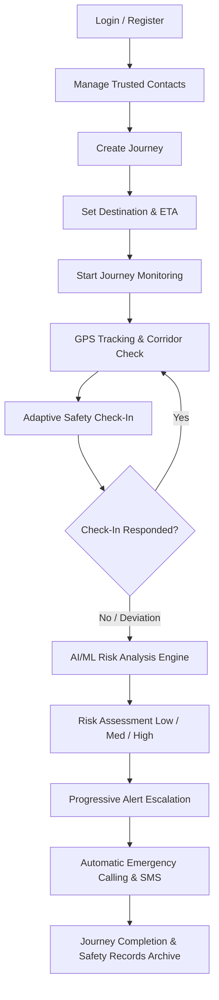

# JOURNEX

> **Smart Women's Safety Check-In and Journey Monitoring System**  
> *Final-Year Engineering Project*

---

## 📌 Project Overview

**JOURNEX** is a dedicated travel safety mobile application designed to protect women during daily commutes, late-night travels, and unfamiliar journeys. Unlike conventional SOS applications that require manual triggers during emergencies (when a user might be physically incapacitated or unable to access their device), JOURNEX combines **active journey tracking**, **adaptive safety check-ins**, and an **AI/ML-based risk assessment engine** to continuously monitor travel parameters and autonomously escalate emergency procedures if anomalies are detected.

---

## 🛠️ Technology Stack

| Domain | Technology | Purpose |
|---|---|---|
| **Mobile Client** | Native Android (Kotlin) | Core application, background GPS services, hardware access |
| **UI Toolkit** | Jetpack Compose | Modern, declarative, accessible, and reactive user interface |
| **Backend API** | Python 3.10+ / Flask | Lightweight, scalable RESTful API service |
| **ORM & Database** | SQLAlchemy / SQLite & MySQL | Object Relational Mapping; SQLite for local dev, MySQL ready |
| **Machine Learning**| Scikit-learn (Random Forest) | Predictive risk assessment based on journey anomaly features |
| **Location Services**| Google Play Services Location | Accurate real-time GPS tracking with geofencing and polyline checks |

---

## 🌟 The 18 Mandatory Features

1. **User Registration & Login**: Secure account creation, user profile verification, and session management.
2. **Personal Safety Profile**: Storage of critical medical information, blood group, home address, and personal notes.
3. **Trusted Emergency Contact Management**: Addition, verification, and prioritization of guardians and emergency contacts with SMS/call capabilities.
4. **Destination & Expected Arrival Time Setup**: Intuitive journey configuration specifying source, destination, estimated travel time, and selected transit mode.
5. **GPS-Based Journey Monitoring**: Real-time foreground tracking of live user coordinates and velocity along established transit corridors.
6. **Adaptive Safety Check-In**: Dynamic, context-sensitive prompts asking the traveler to confirm their safety at calculated intervals.
7. **Missed Check-In & Delay Detection**: Automated identification of overdue check-in confirmations and unexpected journey duration spikes.
8. **Route Deviation & Unexpected Stop Detection**: Spatial algorithmic checks detecting deviations from planned corridors or extended halts in unusual areas.
9. **AI/ML-Based Risk Analysis**: Random Forest classification model evaluating journey parameters (time of day, deviation magnitude, delay, check-in responsiveness) to compute real-time risk tiers (*Low*, *Medium*, *High*).
10. **Multi-Level Emergency Alert Escalation**: Progressive notification cascade (In-app prompt -> Soft warning notification -> Guardian SMS with live location link -> Escalated distress alert).
11. **SOS & Silent Safety Check**: One-tap instant panic button alongside discreet, silent distress verification triggers for covert situations.
12. **Automatic Emergency Calling**: Autonomous telephony trigger dialing primary guardians or emergency dispatch when Tier-3 High Risk thresholds are breached.
13. **Journey History & Safety Records**: Comprehensive archival of past trips, safety ratings, routes traveled, and logged anomaly timestamps.
14. **Safe Exit / Fake Call**: In-app simulated incoming call tool providing a realistic escape mechanism from uncomfortable or threatening social interactions.
15. **Safe Places Directory**: Curated local directory and map view of 24/7 verified safe havens (police stations, hospitals, transit kiosks, safe transit hubs).
16. **Safety Incident Journal**: Private, timestamped incident logging tool allowing users to record suspicious occurrences, license plates, or notes for legal/reporting purposes.
17. **Privacy Controls**: Granular user consent toggles for location broadcasting, history retention, and background monitoring status.
18. **Demo Simulation Mode**: Pre-configured mock location playback and event trigger module allowing comprehensive viva, evaluator demonstrations, and test execution without physical travel.

---

## 🔄 Mandatory Application Flow



1. **Authentication**: User logs in with secure credentials.
2. **Setup Guardians**: Traveler configures trusted emergency contacts with phone numbers and priority orders.
3. **Plan Journey**: User inputs start point, destination, travel mode, and calculated Expected Time of Arrival (ETA).
4. **Initiate Monitoring**: GPS tracking starts via an Android Foreground Service with continuous coordinate capture.
5. **Adaptive Check-In**: Time-based and event-based safety prompts appear.
6. **Risk Analysis**: Machine Learning model analyzes spatial deviations, unexpected stops, delays, and responsiveness.
7. **Escalation**: If risk is elevated or a check-in is missed, multi-level alert escalation notifies guardians with live GPS coordinates.
8. **Emergency Action**: Automatic emergency calling is dispatched if critical high-risk criteria are met.
9. **Archival**: Upon arrival, the journey log and safety metrics are saved to the history database.

---

## 📂 Monorepo Directory Layout

```
JOURNEX/
├── .gitignore               # Unified git exclusion rules for Android, Python & ML
├── README.md                # Project landing documentation (this file)
├── docs/                    # Architectural and academic project documentation
│   ├── PROJECT_SPEC.md      # Comprehensive specifications & feature breakdown
│   ├── ARCHITECTURE.md      # Detailed system architecture, data models & API specs
│   ├── ROADMAP.md           # Implementation phases, sprints & testing milestones
│   └── DECISIONS.md         # Architecture Decision Records (ADRs)
├── android/                 # Native Android Application (Kotlin + Jetpack Compose)
│   └── README.md            # Android setup instructions and module breakdown
├── backend/                 # Flask REST API Microservice
│   ├── app/                 # Application package (routes, models, controllers)
│   ├── tests/               # Backend API and integration test suite
│   ├── README.md            # Backend setup, virtual environment, and run guide
│   └── requirements.txt     # Python dependencies for API service
└── ml/                      # Scikit-Learn Random Forest Risk Engine
    ├── data/                # Sample and synthetic journey training data
    ├── models/              # Serialized ML model artifacts (.joblib/.pkl)
    ├── notebooks/           # Exploratory Data Analysis & model training notebooks
    ├── src/                 # Feature extraction & inference pipeline source
    ├── README.md            # ML pipeline workflow, features & training guide
    └── requirements.txt     # Python dependencies for ML experimentation
```

---

## 🚀 Getting Started

### Prerequisites

1. **Android Development**: Android Studio Ladybug or newer, JDK 17+, Android SDK 34+.
2. **Backend & ML**: Python 3.10 or newer, virtual environment tool (`venv`).
3. **Version Control**: Git.

### Setup Instructions

Detailed setup guides for each component are maintained in their respective folders:
- [Android Application Guide](android/README.md)
- [Backend REST API Guide](backend/README.md)
- [Machine Learning Engine Guide](ml/README.md)
- [System Architecture Details](docs/ARCHITECTURE.md)
- [Project Specification](docs/PROJECT_SPEC.md)

---

## 🔒 Code of Ethics & Privacy

JOURNEX is engineered with a strict **Privacy-by-Design** philosophy. Location coordinates are tracked exclusively during active journeys and are only transmitted to backend services or emergency contacts when safety escalation protocols are triggered or explicitly permitted by the traveler.
