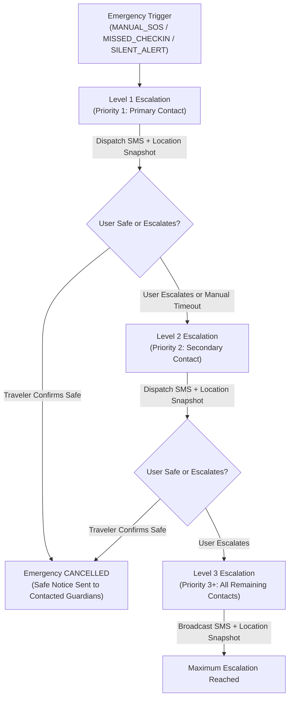
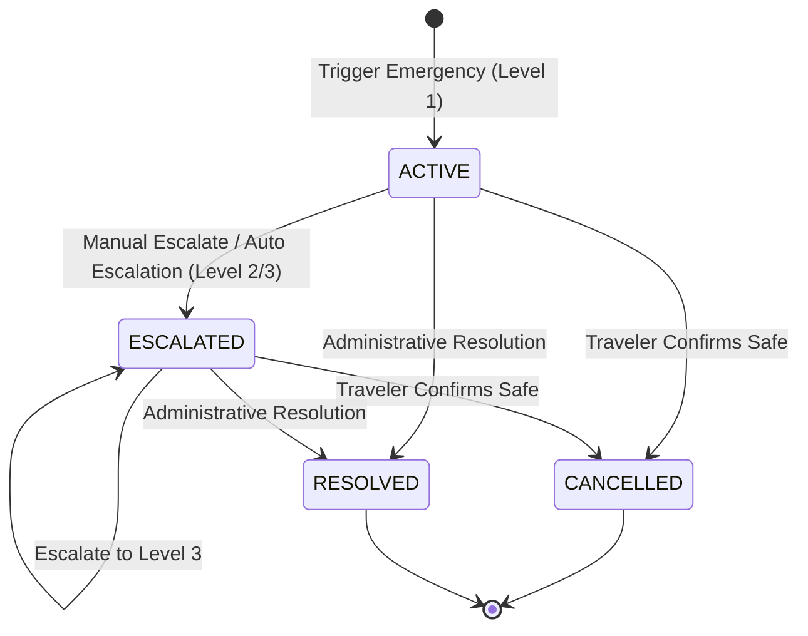

# JOURNEX – Phase 8: SOS & Multi-Level Emergency Alert Escalation System Design

**Project:** JOURNEX – Smart Women's Safety Check-In and Journey Monitoring System  
**Document:** System Design & Technical Specification  
**Component:** Emergency Alert Subsystem (`backend/app/services/emergency_service.py`, `android/`)  
**Version:** 1.0.0  
**Phase:** 8  

---

## 1. System Overview & Objectives

In extreme safety situations, a personal safety platform must deliver rapid, predictable, and fail-safe emergency dispatch. The **JOURNEX SOS & Multi-Level Emergency Escalation Subsystem** provides a user-governed emergency response pipeline designed for resilience across cellular network interruptions, user panic, and escalating threats.

### Core Objectives:
1. **User Control & Agency:** The traveler always retains full control over emergency triggering and cancellation.
2. **Multi-Level Escalation Hierarchy:** Progressive alerting prevents unnecessary panic by notifying primary guardians first, then escalating to secondary and broader networks if unacknowledged or manually escalated.
3. **Pluggable Provider Abstraction:** Clean `AlertProviderInterface` decoupling application logic from external SMS/telephony gateways with zero hardcoded API keys.
4. **Idempotency & Deduplication:** Client-generated action UUIDs prevent duplicate SMS transmissions during network retries.
5. **Auditable Lifecycle & State Machine:** Enforces valid transitions across `ACTIVE`, `ESCALATED`, `CANCELLED`, and `RESOLVED` states.
6. **Cancellation Protocol:** Cancelling an alert automatically dispatches follow-up safe notices to all previously notified contacts, preventing panic and unnecessary search efforts.
7. **Safe Dialer Integration:** Prompts native telephony using `Intent.ACTION_DIAL` so the user explicitly authorizes phone calls, strictly prohibiting covert or unapproved dialing.
8. **Decoupled from ML Risk Engine:** High ML risk scores **never** trigger automatic emergency dispatches or phone calls. Manual SOS remains available at all times regardless of ML output.

---

## 2. Multi-Level Escalation Model

Escalation leverages the traveler's existing trusted emergency contacts, ordered by priority rank:



### 2.1 Escalation Tiers:
- **Level 1 (Primary Contact):**
  - Targets the primary guardian (Priority 1, e.g., Mother, Spouse).
  - Sends immediate SMS with emergency alert, traveler's live coordinates, and location address.
- **Level 2 (Secondary Contact):**
  - Targets the secondary contact (Priority 2, e.g., Father, Hostel Warden).
  - Dispatches follow-up SMS indicating Level 2 escalation and current coordinates.
- **Level 3 (Remaining Guardians):**
  - Dispatches to all remaining trusted contacts (Priority $\ge$ 3, e.g., Friends, Colleagues).
  - Serves as the full-circle safety safety net.

### 2.2 Trigger Types:
- `MANUAL_SOS`: Explicitly triggered by traveler pressing the SOS Panic control on Dashboard or Active Journey screen.
- `MISSED_CHECKIN_ESCALATION`: Triggered when an active journey check-in window expires unacknowledged past timeout limits.
- `SILENT_ALERT`: Discreet panic trigger without audio sirens, visual flashing, or tactile alarms, protecting traveler in vulnerable captive scenarios.

---

## 3. Provider Abstraction Architecture

Alert dispatching adheres to Dependency Inversion via `AlertProviderInterface`:

```python
class AlertProviderInterface(ABC):
    @abstractmethod
    def send_sms(self, recipient_phone: str, message_body: str) -> Dict[str, Any]:
        """
        Send an SMS alert to a recipient phone number.
        Returns dictionary with:
            success: bool
            provider_message_id: str or None
            status: str ("SENT", "DELIVERED", "FAILED")
            error_message: str or None
        """
        pass
```

### 3.1 MockAlertProvider
- Used during development, testing, and continuous integration.
- Configurable failure simulation (`simulate_failure = True`) and delivery latency simulation.
- Records all dispatched messages in-memory for testing assertions.
- Requires zero third-party accounts or external API costs.

### 3.2 Production Gateway Adapters
- Pluggable implementations (`TwilioAlertProvider`, `AwsSnsAlertProvider`, `InfobipAlertProvider`).
- Initialized dynamically via environment variables (`ALERT_PROVIDER=twilio`, `TWILIO_ACCOUNT_SID`, etc.).
- Never commit credentials to source control.

---

## 4. State Machine & Lifecycle Transitions



### State Definitions:
- **`ACTIVE`:** Emergency initiated. Level 1 notifications dispatched.
- **`ESCALATED`:** Alert level raised to Level 2 or Level 3; additional contacts notified.
- **`CANCELLED`:** Traveler confirmed safe via app with PIN or explicit confirmation dialog.
- **`RESOLVED`:** Incident resolved and archived.

### Cancellation Protocol:
When `cancel_emergency_event()` is invoked:
1. Event status is transitioned to `CANCELLED`.
2. `cancelled_at` timestamp and `cancellation_reason` are saved.
3. System iterates over all unique contacts notified in previous dispatches.
4. An immediate SMS notice is sent:
   `"JOURNEX NOTICE: [Name] has cancelled the emergency alert and confirmed they are safe at [Timestamp]."`
5. This completely mitigates false alarm panic and stops unnecessary guardian dispatch.

---

## 5. Security, Ethics, and Privacy Guarantees

1. **User Isolation & Multi-Tenancy:**
   All queries validate `emergency_event.user_id == current_user_id`. Attempting to access or escalate an event belonging to another user produces HTTP 403 Forbidden.
2. **No Autonomous Calling:**
   The application **never** uses `android.permission.CALL_PHONE` without user intervention. All calling actions invoke `Intent.ACTION_DIAL`, presenting the phone dialer to the user with the guardian's number prefilled for explicit manual confirmation.
3. **Audit Trail & Non-Repudiation:**
   Every dispatch stores recipient phone, contact ID, channel, provider message ID, and delivery status in `emergency_alert_dispatches`.
4. **Resilience to ML False Positives:**
   High risk classifications from the Random Forest model never directly trigger emergency dispatches. Travelers are empowered with telemetry awareness, keeping emergency dispatches deliberate and trusted.
