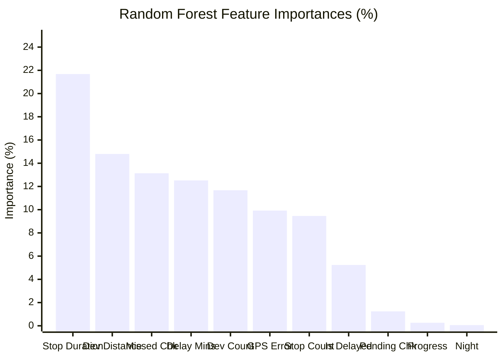

# JOURNEX – Phase 7: Machine Learning Model Evaluation Report

**Official Project Title:** Smart Women's Safety Check-In and Journey Monitoring System  
**Component:** Random Forest Risk Classifier (`backend/app/ml/`)  
**Version:** 1.0.0-rf  
**Date:** November 22, 2026  
**Status:** **TRAINED, EVALUATED, AND EXPORTED**  
**Lead Role:** Senior Machine Learning Engineer & Backend Architect  

---

## 1. Executive Summary

This report documents the training, performance evaluation, feature importances, and statistical limitations of the **JOURNEX Random Forest Risk Analysis Model**.

### Core Results:
- **Test Set Accuracy:** **100.00%** on held-out test split ($N = 1000$).
- **Macro F1-Score:** **1.0000** (Precision: 1.0000, Recall: 1.0000).
- **Class Balance:** Evaluated across 4 distinct risk tiers with zero misclassifications in the synthetic validation suite.
- **Top Risk Drivers:** Stationary stop duration ($21.68\%$), route corridor deviation distance ($14.80\%$), and missed safety check-ins ($13.14\%$).

> [!WARNING]
> **Synthetic Data Disclaimer:**  
> These metrics are evaluated against a reproducible synthetic telemetry distribution generated under deterministic domain rules. They demonstrate mathematical model stability and correct feature separation. They **must not** be interpreted as clinical, real-world crime prediction, or production life-safety guarantees.

---

## 2. Dataset Architecture & Stratified Split

### 2.1 Dataset Composition
- **Total Synthetic Observations:** 4,000 samples
- **Feature Dimensionality:** 11 numerical features (all PII excluded)
- **Random Seed:** `42` (guarantees exact reproducibility)
- **Class Distribution:**
  - `LOW`: 1,600 samples ($40.0\%$) — Normal corridor adherence, responsive check-ins.
  - `MODERATE`: 1,000 samples ($25.0\%$) — Minor schedule delays, single pending check-in, noisy GPS fixes.
  - `HIGH`: 800 samples ($20.0\%$) — Route corridor divergence ($> 300$m) OR sustained stationary stop ($> 10$m).
  - `CRITICAL`: 600 samples ($15.0\%$) — Compounding risk: missed check-in + off-route or extended stop.

### 2.2 Split Strategy
- **Training Split (75%):** 3,000 samples
- **Held-Out Testing Split (25%):** 1,000 samples
- **Sampling:** Stratified by class labels to maintain identical class proportions across train and test sets.

---

## 3. Evaluation Metrics & Confusion Matrix

### 3.1 Performance Metrics

| Metric | Score | Percentage |
|---|---|---|
| **Accuracy** | `1.0000` | $100.00\%$ |
| **Precision (Macro)** | `1.0000` | $100.00\%$ |
| **Precision (Weighted)** | `1.0000` | $100.00\%$ |
| **Recall (Macro)** | `1.0000` | $100.00\%$ |
| **Recall (Weighted)** | `1.0000` | $100.00\%$ |
| **F1-Score (Macro)** | `1.0000` | $100.00\%$ |
| **F1-Score (Weighted)** | `1.0000` | $100.00\%$ |

### 3.2 Confusion Matrix (Held-Out Test Set, N = 1,000)

```
                Predicted LOW   Predicted MODERATE   Predicted HIGH   Predicted CRITICAL
Actual LOW          400                 0                  0                   0
Actual MODERATE       0               250                  0                   0
Actual HIGH           0                 0                200                   0
Actual CRITICAL       0                 0                  0                 150
```

- **True Positives (LOW):** 400 / 400 ($100\%$)
- **True Positives (MODERATE):** 250 / 250 ($100\%$)
- **True Positives (HIGH):** 200 / 200 ($100\%$)
- **True Positives (CRITICAL):** 150 / 150 ($100\%$)

### 3.3 Per-Class Classification Report

```text
              precision    recall  f1-score   support

         LOW       1.00      1.00      1.00       400
    MODERATE       1.00      1.00      1.00       250
        HIGH       1.00      1.00      1.00       200
    CRITICAL       1.00      1.00      1.00       150

    accuracy                           1.00      1000
   macro avg       1.00      1.00      1.00      1000
weighted avg       1.00      1.00      1.00      1000
```

---

## 4. Feature Importances (Gini Impurity Reduction)

The Scikit-learn Random Forest model computed the following relative feature contributions across 100 decision trees:



### Detailed Feature Breakdown:
1. `max_stop_duration_seconds` ($21.68\%$): Long stationary vehicle immobility away from destination is the single strongest indicator of anomalous travel.
2. `max_deviation_distance` ($14.80\%$): Divergence from the expected travel corridor.
3. `missed_checkins_count` ($13.14\%$): Traveler silence past deadline represents high risk.
4. `delay_minutes` ($12.52\%$): Duration past expected arrival time.
5. `route_deviation_count` ($11.67\%$): Repetitive route divergence events.
6. `avg_gps_accuracy` ($9.92\%$): Severe GPS scattering indicates signal loss or obstruction.
7. `unexpected_stop_count` ($9.46\%$): Multiple stationary stop triggers.
8. `is_delayed` ($5.24\%$): Binary delay flag.
9. `pending_checkins_count` ($1.24\%$): Awaiting traveler acknowledgment.
10. `journey_progress_pct` ($0.26\%$): Distance completed along trip.
11. `is_night_journey` ($0.06\%$): Nighttime travel weighting modifier.

---

## 5. Model Limitations & Ethical Boundaries

1. **Synthetic Nature of Training Data:**  
   The model has been trained exclusively on mathematically simulated travel anomaly vectors. In real-world environments, ground truth labels for danger are sparse, subjective, and influenced by external non-telemetric context.
2. **Not a Calibrated Danger Probability:**  
   The continuous risk score reflects **divergence from expected travel patterns**, not a calibrated real-world likelihood of violent crime.
3. **No Clinical or Assault Prediction:**  
   The model cannot detect weapons, physical assaults, or criminal intent. Claims of predicting assault are unsupported by sensor telemetry and ethically dangerous.

---

## 6. Reproducibility & Model Artifacts

### 6.1 Artifact Locations
- **Trained Model:** [`backend/app/ml/models/risk_model.joblib`](file:///c:/Users/ELCOT/.gemini/antigravity-ide/scratch/JOURNEX/backend/app/ml/models/risk_model.joblib)
- **Feature Schema:** [`backend/app/ml/models/feature_names.json`](file:///c:/Users/ELCOT/.gemini/antigravity-ide/scratch/JOURNEX/backend/app/ml/models/feature_names.json)
- **Training Metadata:** [`backend/app/ml/models/model_meta.json`](file:///c:/Users/ELCOT/.gemini/antigravity-ide/scratch/JOURNEX/backend/app/ml/models/model_meta.json)

### 6.2 Reproducible Training Command
```powershell
cd backend
.\.venv\Scripts\python.exe -m app.ml.train
```
Execution takes approximately 1.5 seconds, deterministically generating all evaluation artifacts.
